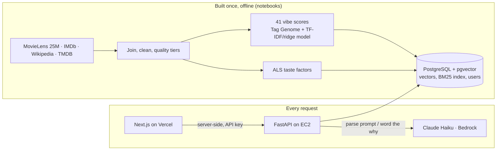

# VibeRec

**Movie recommendations by how a film feels.** Name a film you love and the feel you want — *"something like How to Lose a Guy in 10 Days, but more urban"* — and VibeRec returns films with that vibe, each with a one-line reason it fits. A short taste quiz builds a personal "For you" list, and every choice is explained from the actual parts of its score.

Built end to end: data collection and statistics, a learned "vibe" model, collaborative filtering, learning to rank, LLM-powered search, explainability, a PostgreSQL + pgvector back end on AWS, and a Next.js front end.

## What it does

- **Search by vibe.** An LLM (Claude Haiku on AWS Bedrock) turns a free-text prompt into structured fields — the sample film, the vibes wanted more or less of, genres, keywords. A hybrid search then fuses vibe similarity, keyword (BM25) matches and closeness to the sample film, and reorders the results toward familiar films that aren't older than the sample.
- **Taste quiz.** Like / not for me / haven't seen, one poster at a time, until you've liked 20 films. The questions were chosen by optimal experiment design on the collaborative-filtering factors.
- **For you.** A personal list from your likes: the quiz answers are folded into the ALS model and blended with your vibe profile.
- **Explanations.** Every result's "why" is built only from the score components that actually ranked it (and a spoiler-free premise), then worded by the LLM under strict rules: no spoilers, no invented facts. A checker falls back to a template when a sentence breaks them.
- **Profiles and history.** Guests (random cookie id) or members (Clerk sign-in) get a taste profile and a full history of searches, results shown and reactions. Signing up merges guest history; "Forget me" anonymises it.

## How it works



## Results

Every component had to beat a simpler baseline on a time-based split (train on ratings before 2018-01-04, test on what 5,000 users liked afterwards), with paired bootstrap intervals; 77 methods are recorded on one scoreboard.

| Component | Result | Baseline |
|---|---|---|
| Vibe model (TF-IDF + ridge on Wikipedia plot + reception), 41 vibes | median Spearman **0.61** vs the Tag Genome | genre-only 0.37; sentence embeddings 0.56; zero-shot vector search 0.22 |
| Quality tiers (Bayesian-shrunk rating, k = 7.3 from a reliability curve) | 21% of films excluded; validated on later ratings, AUC 0.70–0.98 | raw-mean rule |
| Collaborative filtering (ALS, 128 factors) + vibe blend | recall@10 **0.0540**, +7% over ALS alone | popularity 0.0229, item-to-item 0.0395 |
| LightGBM LambdaRank re-ranker (top-300 candidates) | recall@10 **0.0764**, +41% over the blend; NDCG@10 +25% | weighted score (logistic regression), Random Forest |
| Taste quiz (D-optimal questions, stop at 20 likes) | taste recall **+22%** over a fixed 30 questions | popular / random / adaptive questions |
| LLM prompt parsing | precision@10 **+23%** on vibe queries; sample film found 93% → 100% | rule-based parser with a learned router |
| Explanations | SHAP top driver removed → item drops 56 places (random feature: 9); search "why" leads with the true biggest cause 93% of the time | global feature importance |
| Search in PostgreSQL + pgvector | 99% top-10 agreement with the research implementation, **0.09 s** per query | in-memory numpy |

Techniques that lost their tests were dropped, and the losses are recorded too: PCA and clustering (recall −1% to −29%), HDBSCAN (no natural groups), embeddings for the vibe scores, an LLM replacing the vibe model (0.41 vs 0.57), and learned fusion weights (−19.5%, they learned "popular = right").

The full decision record, with the evidence for every choice and every rejected alternative, is in [`docs/DECISIONS.md`](docs/DECISIONS.md); analysis write-ups are in [`docs/findings/`](docs/findings/).

## Tech stack

**Data and ML:** Python, pandas, PyArrow, SciPy, scikit-learn, implicit (ALS), LightGBM, sentence-transformers, TreeSHAP explanations (LightGBM)
**LLM:** Claude Haiku 4.5 on AWS Bedrock (structured tool calls, caching, spend guard)
**Back end:** FastAPI, PostgreSQL 16 + pgvector, Docker
**Front end:** Next.js 15, React 19, Tailwind CSS 4, Clerk
**Cloud:** AWS EC2, S3, IAM, Bedrock, CloudFormation; Vercel
**Testing:** pytest (147 tests), notebook gates that compare served results with the research code

## Repository layout

```
notebooks/   01–17: data collection → EDA → tiers → vibes → CF → onboarding → search → ranker → explanations → serving
src/viberec/ reusable code (each module tested in tests/)
app/         FastAPI service (search, quiz, feed, profiles, history)
web/         Next.js website
deploy/      Dockerfile, CloudFormation stack, server scripts
docs/        decision log, saved-outputs index, analysis write-ups
tests/       pytest suite
```

## Running it locally

Prerequisites: Python 3.12, Node.js 20+, Docker, and (for the LLM parts) an AWS account with Bedrock access to Claude Haiku.

```bash
python -m venv .venv && source .venv/bin/activate
pip install -r requirements.txt
cp .env.example .env            # add a TMDB key and an API key of your choice
```

1. **Data.** `notebooks/01_collect.ipynb` downloads [MovieLens 25M](https://grouplens.org/datasets/movielens/25m/) and the [IMDb datasets](https://developer.imdb.com/non-commercial-datasets/) into `data/raw/`. Run the notebooks in order; each saves its outputs and later notebooks load them.
2. **Tests.** `pytest`
3. **Database.** `docker compose -f deploy/docker-compose.yml up -d`, then notebooks 16 and 17 load the catalog, vectors and posters.
4. **API.** `uvicorn app.main:app --port 8000`
5. **Website.** `cd web && cp .env.example .env.local && npm install && npm run dev` → http://localhost:3000

Deployment: `deploy/viberec-stack.yaml` creates the AWS resources (EC2, S3, IAM role); `deploy/update_server.sh` installs the app image, database backup and nightly backups.

## Data and attribution

- Ratings and the Tag Genome: MovieLens 25M, F. Maxwell Harper and Joseph A. Konstan, *ACM TiiS* 2015. The dataset is not redistributed here.
- Film metadata: IMDb non-commercial datasets; plots and critics' reception: Wikipedia.
- This product uses the TMDB API but is not endorsed or certified by TMDB.

## Author

**Md Ajmain Adil**
